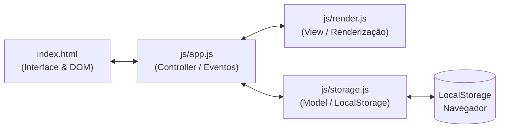

# 📝 To-Do List — Gerenciador Inteligente de Tarefas

> **Projeto desenvolvido durante a Imersão Engenharia de Software: Dev na Era da IA — Alura & Google**  
> Uma aplicação moderna, modular e de alta performance construída através da orquestração avançada de Agentes de IA.

---

<div align="center">


</div>

---

## 📌 Sumário
- [Sobre o Projeto](#-sobre-o-projeto)
- [🚀 Imersão Engenharia de Software: Dev na Era da IA](#-imersão-engenharia-de-software-dev-na-era-da-ia-alura--google)
- [🤖 Desenvolvimento Orientado por Agentes (Agentic Workflow)](#-desenvolvimento-orientado-por-agentes-agentic-workflow)
  - [O Framework GCCD](#o-framework-gccd)
  - [Diretrizes com AGENTS.md](#diretrizes-com-agentsmd)
  - [Técnica de Alinhamento: Grill Me](#técnica-de-alinhamento-grill-me)
  - [Ferramental Tecnológico](#ferramental-tecnológico)
- [✨ Funcionalidades e Recursos de UX](#-funcionalidades-e-recursos-de-ux)
- [🛠️ Arquitetura e Estrutura do Projeto](#️-arquitetura-e-estrutura-do-projeto)
  - [Estrutura de Pastas](#estrutura-de-pastas)
  - [Responsabilidade dos Módulos](#responsabilidade-dos-módulos)
- [💻 Como Executar o Projeto Localmente](#-como-executar-o-projeto-localmente)
- [👤 Autor & Redes](#-autor--redes)

---

## 📖 Sobre o Projeto

O **To-Do List** é uma Single Page Application (SPA) modular, rápida, intuitiva e acessível, projetada para o gerenciamento fluido de tarefas pessoais e rotinas diárias. 

Construído sob os princípios de **Clean Code**, **Mobile-First** e **Vanilla Architecture** (sem a dependência de frameworks pesados ou bibliotecas externas), o sistema oferece uma experiência fluida com persistência local de dados (`localStorage`), alternância dinâmica de tema (Dark/Light Mode), edição inline e sanitização rigorosa contra vulnerabilidades XSS.

Mais do que uma ferramenta funcional, este repositório é um **estudo de caso prático de Engenharia de Software Moderna**, demonstrando como arquitetar, planejar e entregar software de qualidade industrial através do direcionamento e da supervisão de **agentes autônomos de Inteligência Artificial**.

---

## 🚀 Imersão Engenharia de Software: Dev na Era da IA (Alura + Google)

Este software é fruto do desafio prático promovido na **Imersão Engenharia de Software: Dev na Era da IA**, realizada pela **Alura** em colaboração estratégica com o **Google**.

### ⚡ A Mudança de Paradigma na Engenharia de Software

O ecossistema global de desenvolvimento passa por sua transformação mais radical desde o advento da computação em nuvem. A forma tradicional de programar — centrada apenas na digitação manual de linhas de código ou em autocompletes passivos — tornou-se insuficiente frente às demandas contemporâneas.

```
ERA ANTERIOR                            ERA ATUAL (AGENTIC ERA)
┌────────────────────────┐              ┌───────────────────────────────────────┐
│  Prompting Isolado     │              │  Orquestração de Agentes Autônomos    │
│  "Copiar e colar"      │   ───────►   │  Context Engineering + GCCD Framework │
│  Foco em sintaxe pura  │              │  Supervisão de Arquitetura & UX       │
└────────────────────────┘              └───────────────────────────────────────┘
```

A imersão enfatizou que o verdadeiro diferencial competitivo do profissional de tecnologia agora reside em:
1. **Pensamento Crítico de Engenharia:** Capacidade de decompor problemas complexos, prever cenários de falha, desenhar fronteiras de componentes e orquestrar múltiplos fluxos de entrega.
2. **Context Engineering:** Saber fornecer o contexto semântico, regras de negócio e restrições corretas para que modelos de fundação e agentes operem com máxima assertividade.
3. **Orquestração Multiagente:** Atuar não apenas como mero digitador, mas como o **arquiteto-chefe** que guia, desafia, audita e valida a execução autônoma de tarefas no ciclo de vida do software (SDLC).

---

## 🤖 Desenvolvimento Orientado por Agentes (Agentic Workflow)

O ciclo de vida deste projeto foi totalmente conduzido através de fluxos de trabalho agentificados (*Agentic Engineering*), aplicando metodologias estruturadas de especificação e alinhamento contínuo:

### O Framework GCCD

Para garantir previsibilidade, clareza e evitar alucinações, cada ciclo de desenvolvimento utilizou o modelo **GCCD**:

| Pilar | Descrição | Aplicação no Projeto |
| :--- | :--- | :--- |
| **🎯 Goal (Objetivo)** | A meta macro e o propósito primário da entrega. | Criação de uma SPA de Lista de Tarefas com CRUD completo e suporte a temas. |
| **🧠 Context (Contexto)** | O ecossistema técnico, público-alvo e dependências. | Vanilla JS ES6+ Modules, HTML5 semântico, CSS puro e persistência local. |
| **⚠️ Constraints (Restrições)** | Regras não negociáveis, segurança e padrões. | Sanitização XSS, sem frameworks externos, Mobile-First e preservação de comentários. |
| **📦 Deliverables (Entregáveis)** | Critérios de aceite granulares e mensuráveis. | Checklist de funcionalidades com atalhos de teclado e persistência no storage. |

### Diretrizes com `AGENTS.md`

O repositório conta com um arquivo [AGENTS.md](file:///home/caualopes_icm/AGENTS.md) na raiz do projeto. Ele atua como o manual comportamental e contrato de engenharia do agente inteligente:
- Define a **Persona** (Desenvolvedor Frontend Sênior focado em Clean Code e UX).
- Estabelece regras de **Separação de Responsabilidades** (Data Layer isolada da Presentation Layer).
- Impõe boas práticas de integridade (modificações incrementais, preservação de documentação).

### Técnica de Alinhamento: `Grill Me`

Antes da implementação de funcionalidades críticas (como o sistema de edição inline ou a persistência desacoplada), foi utilizada a abordagem interativa `/grill-me`. 
Nessa dinâmica, a IA entrevista o engenheiro, levantando casos de borda, restrições de acessibilidade e potenciais ambiguidades de design antes de gerar qualquer linha de código. O resultado é um alinhamento arquitetural prévio com retrabalho zero.

### Ferramental Tecnológico
- **Google Antigravity:** Ambiente de orquestração agentica e automação de engenharia.
- **Google AI Studio & Modelos Gemini:** Raciocínio multietapa para refinamento de código, sanitização e arquitetura limpa.

---

## ✨ Funcionalidades e Recursos de UX

- **📥 Criação Rápida de Tarefas:** Validação de texto não-vazio, suporte ao teclado via tecla `Enter` e feedback visual de erro com animação de vibração (*input shake*).
- **📋 Renderização Reativa:** Listagem instantânea de tarefas com identificadores únicos gerados via `crypto.randomUUID()`.
- **✅ Conclusão de Tarefas:** Checkbox acessível que atualiza o estado com transição visual imediata (tachado, opacidade reduzida).
- **✏️ Edição Inline Multimodal:** Edição direta do texto pelo botão de lápis ou via duplo clique na tarefa, com confirmação por `Enter`/perda de foco (`blur`) e cancelamento por `Esc`.
- **🗑️ Remoção com Microinterações:** Exclusão individual com animação suave de saída (*slide-out & fade*) antes da deleção no armazenamento.
- **🧹 Limpeza em Massa:** Botão dedicado para remover todas as tarefas concluídas em uma única ação.
- **🔍 Filtros Dinâmicos:** Segmentação rápida por status:
  - *Todas*
  - *Pendentes*
  - *Concluídas*
- **🔢 Contador Inteligente:** Exibição em tempo real da quantidade de tarefas pendentes restantes.
- **🌓 Dark & Light Mode:**
  - Alternador dinâmico de tema com ícones vetoriais SVG (sol/lua).
  - Detecção automática da preferência do sistema operacional (`prefers-color-scheme`).
  - Persistência da preferência escolhida no `localStorage`.
- **🛡️ Segurança & Sanitização:** Proteção em nível de código contra injeção de scripts (XSS) com escape de entidades HTML.

---

## 🛠️ Arquitetura e Estrutura do Projeto

O projeto adota uma arquitetura modular limpa (*Clean Vanilla Architecture*), desacoplando a camada de armazenamento, regras de negócio e renderização no DOM:

### Estrutura de Pastas

```text
To-do-List-Dev-na-Era-da-IA---Alura/
├── index.html            # Estrutura semântica, acessibilidade e containers
├── css/
│   └── styles.css        # Design system com variáveis CSS, responsividade e animações
├── js/
│   ├── app.js            # Ponto de entrada, eventos e orquestração de estado
│   ├── storage.js        # Persistência de dados, sanitização e CRUD no localStorage
│   └── render.js         # Manipulação de DOM, SVGs, templates e animações
├── AGENTS.md             # Contrato de diretrizes e restrições para agentes de IA
└── README.md             # Documentação técnica completa do projeto
```

### Responsabilidade dos Módulos



- **[`app.js`](file:///home/caualopes_icm/js/app.js):** Atua como o *Controller* da aplicação. Gerencia o estado de filtros, registra todos os ouvintes de eventos globais, delega ações de interação do usuário e coordena a comunicação entre a interface e os dados.
- **[`storage.js`](file:///home/caualopes_icm/js/storage.js):** Camada de dados (*Model*). Centraliza as chaves do `localStorage`, funções de CRUD (`addTask`, `toggleTask`, `updateTaskText`, `deleteTask`, `clearCompletedTasks`), geração de UUIDs e a função pura `sanitizeText()` para proteção contra XSS.
- **[`render.js`](file:///home/caualopes_icm/js/render.js):** Camada de visualização (*View*). Monta os nós do DOM com SVGs embutidos, orquestra animações de transição, injeta formulários de edição inline acessíveis e renderiza estados vazios (*empty states*).
- **[`styles.css`](file:///home/caualopes_icm/css/styles.css):** Design system coeso construído com variáveis customizadas para suporte transparente a temas claro/escuro, layout responsivo via CSS Flexbox/Grid e animações CSS otimizadas para GPU.

---

## 💻 Como Executar o Projeto Localmente

Como a aplicação foi construída com JavaScript Vanilla modular (ES6 Modules), é necessário executá-la através de um servidor HTTP local para respeitar as políticas de segurança de módulo do navegador (CORS).

### Pré-requisitos
- Um navegador web moderno (Google Chrome, Firefox, Safari ou Edge).
- (Opcional) Node.js, Python ou a extensão Live Server do VS Code.

### Passo a Passo

1. **Clone o repositório:**
   ```bash
   git clone https://github.com/Caualopesrlp/To-do-List-Dev-na-Era-da-IA---Alura.git
   cd To-do-List-Dev-na-Era-da-IA---Alura
   ```

2. **Inicie um servidor local:**

   *Opção A — Com Python 3:*
   ```bash
   python3 -m http.server 8000
   ```

   *Opção B — Com Node.js (`npx serve` ou `http-server`):*
   ```bash
   npx serve .
   ```

   *Opção C — Com a extensão Live Server no VS Code:*
   - Abra o projeto no VS Code.
   - Clique com o botão direito no arquivo `index.html` e selecione **"Open with Live Server"**.

3. **Acesse no navegador:**
   Abra seu navegador e acerte a URL correspondente (ex: `http://localhost:8000`).

---

## 👤 Autor & Redes

Desenvolvido por **Cauã Lopes** durante a **Imersão Engenharia de Software: Dev na Era da IA** (Alura & Google).

- **GitHub:** [@Caualopesrlp](https://github.com/Caualopesrlp)
- **LinkedIn:** [Cauã Lopes](https://www.linkedin.com/in/caualopesrlp/)

---

<div align="center">

**#ImersaoEngenhariadeSoftware** • **#DevNaEraDaIA** • **#Alura** • **#Google**

</div>
